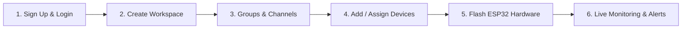

# 🌐 Industrial IoT Platform Mono-Repo

[](https://golang.org)
[](https://react.dev)
[](https://vitejs.dev)
[](https://timescale.com)
[](https://redis.io)
[](https://mosquitto.org)
[](https://firebase.google.com)
[](https://espressif.com)
[](https://docker.com)
[](https://tailwindcss.com)

A high-performance, enterprise-grade multi-tenant IoT platform designed for high-throughput time-series telemetry ingestion, distributed Redis L1 caching, zero-latency SSE streaming, Google Firebase Cloud Messaging (FCM) mobile push alerts, two-way hardware actuation, auto-scaling radial gauges, TimescaleDB continuous aggregates, data exports, remote OTA firmware updates, and single-command containerization.

---

## ⚡ Quick Start for New Users (1-Command Boot)

You can run the **entire platform** (Database, MQTT Broker, Backend API, and Frontend Dashboard) with a single command:

### 1. Prerequisites
- [Docker Desktop](https://www.docker.com/products/docker-desktop/) installed and running.
- [Git](https://git-scm.com/) installed.

### 2. Launch Stack
```bash
git clone <repository-url>
cd iot-platform
docker compose up -d --build
```

### 3. Open Application
* **Web Dashboard:** [`http://localhost:3000`](http://localhost:3000)
* **Backend Healthcheck:** [`http://localhost:8080/health`](http://localhost:8080/health)

**Default Superuser Credentials:**
| Field | Value |
|---|---|
| **Username** | `admin` |
| **Password** | `admin123` |

### 4. Optional: Stream Demo Data Without Hardware
To simulate virtual ESP32 sensor nodes streaming live telemetry into your dashboard:
```bash
go run firmware/tools/simulate_nodes.go
```

> **To stop all services later:** Run `docker compose down`.

---

## 🧭 Complete End-to-End User Journey



### Step 1: Sign Up & Login
1. Open [`http://localhost:3000`](http://localhost:3000).
2. Click **Create an account** on the login screen.
3. Enter your **Full Name**, **Mobile Number**, **Email**, **Username**, and **Password**.
4. Log into your dedicated operator session.

### Step 2: Create Your Workspace (Multi-Tenant Isolation)
1. On initial login, new users are greeted by the **Step 1: Workspace Setup** onboarding card.
2. Enter a **Workspace Name** (e.g. *Smart Factory Alpha*, *Greenhouse Zone 1*) and slug.
3. Click **Create Workspace & Continue**.
4. All telemetry, channels, devices, guardrails, and alarms are isolated strictly to your workspace.
5. Users can also delete workspaces (including their default workspace) anytime. When 0 workspaces remain, the view seamlessly resets to the setup card.

### Step 3: Groups & Telemetry Channels
1. In the sidebar, click **Groups & Channels**.
2. Click **+ Add Channel**:
   - **Channel Name**: e.g., *Deep Freeze Units*
   - **Group Name**: e.g., *Refrigeration*, *HVAC*, *Assembly Line*
   - **Topic Route**: e.g., `channels/chan-cold-01/telemetry`
3. Channels organize edge devices into logical zones and unified MQTT topics.

### Step 4: Register or Assign Sensor Devices
The platform provides flexible device management:

- **Assign Existing Devices into a Channel (Recommended)**:
  - On any channel card, click **+ Add Device**.
  - Under the **"Select Existing Device"** tab, pick any previously created sensor in the workspace from the dropdown.
  - Click **Assign Device to Channel** (or **Move Device to Channel**) to link it with 1 click.
  - Channels dynamically display `Nodes: X connected` and render clickable badges for each device (`[⚡ esp32-sensor-01]`). Click `(×)` on any badge to unlink a device back to standalone status.
- **Register Brand New Device**:
  - In **Clients / Devices** or inside the modal's **"Register Brand New Device"** tab, enter a Device ID (e.g. `esp32-dht22-01`), display name, hardware type, and optional channel.

### Step 5: Connect Physical Hardware (ESP32)
1. Connect your physical ESP32 to your computer via USB.
2. Open the code in **Arduino IDE** or **PlatformIO** (located in `firmware/esp32-dht22` or `firmware/arduino-ide`).
3. Set your local Wi-Fi SSID, Password, and your computer's local LAN IP as the MQTT Host (`192.168.x.x:1883`).
4. Flash the code via USB. Once flashed, the ESP32 connects to Wi-Fi and streams data independently without needing the USB cable!

### Step 6: Live Telemetry Visualization
- Navigate to **Live Dashboard**.
- Pick any device in the top **Active Sensors** selector strip.
- View **Live Metric Cards** or switch to **Auto-Scaling Radial Gauges** (Temperature, Humidity, Heat Index with dynamic headroom padding).
- Your visualization preferences (Card vs Gauge, and Line vs Area vs Stepped vs Bar chart) **persist in `localStorage`**.
- Analyze **Interactive Charts** (continuous 5s updates + zero-latency SSE).
- Toggle **Compare Mode** to evaluate two sensors side-by-side with synchronized historical telemetry downsampling and zero-latency SSE live updates.
- Export sensor datasets to **CSV** or **JSON** with one click.

---

## 📡 What is Over-The-Air (OTA) Update? (Simple Explanation)

**Over-The-Air (OTA)** means updating your ESP32's software **wirelessly over Wi-Fi without needing a USB cable**.

### The Problem It Solves
Imagine an ESP32 mounted 15 feet high on a factory ceiling or sealed inside a waterproof box. If you need to fix a bug or change calculation logic:
- **Without OTA**: You have to bring a ladder and a laptop, climb up, plug in a USB cable, and re-flash the board.
- **With OTA**: You compile your code on your laptop, upload the `.bin` file to the platform dashboard, and click **Trigger OTA**. The ESP32 downloads the update over Wi-Fi, flashes its own memory, and restarts in 10 seconds!

### Fail-Safe "Two-Room" Partitioning
The ESP32 flash memory is split into two slots (**OTA_0** and **OTA_1**):
1. While your device runs in Slot A, it downloads the new code into Slot B.
2. Only after the file is 100% verified does it switch to Slot B and reboot.
3. If Wi-Fi drops midway through downloading, the device safely discards the download and keeps running in Slot A — **it never bricks or dies**.

---

## 🏛️ System Architecture

```
                                  +---------------------------------------+
                                  |   ESP32 Microcontroller Nodes         |
                                  |   (DHT22 Temp, Humidity, Relays, LED) |
                                  +---------------------------------------+
                                           |                      ^
            Upstream Telemetry (Every 5s)  |                      | Downlink Commands
            Topic: devices/<id>/telemetry  |                      | Topic: devices/<id>/commands
            QoS 1, LWT: "offline"          v                      | ACK: devices/<id>/command_ack
                                  +---------------------------------------+
                                  |   Eclipse Mosquitto Broker (:1883)    |
                                  |   - Native TCP MQTT on Port 1883      |
                                  |   - WebSocket MQTT on Port 9001       |
                                  +---------------------------------------+
                                                       |
                                                       | Paho MQTT Subscriber / Publisher
                                                       v
                                  +---------------------------------------+
                                  |         Go Backend Server (:8080)     |
                                  |  - Dual Mode (TimescaleDB + In-Memory)|
                                  |  - SSE Broker (:stream, 0ms latency)  |
                                  |  - Device Registry & CRUD Handlers    |
                                  |  - Dynamic Channel Aggregation Engine |
                                  |  - Outbound Alert Dispatchers         |
                                  |  - Continuous Rollups & Downsampler   |
                                  |  - CSV/JSON Data Streaming Exporter   |
                                  |  - OTA Firmware Binary Server         |
                                  +---------------------------------------+
                                           |                      |
             SQL Writes & Continuous Aggs  |                      | Real-Time SSE Stream / REST API
                                           v                      v
        +-------------------------------------+        +-------------------------------------+
        |     TimescaleDB (PostgreSQL 16)     |        |   React 18 + Vite Dashboard (:3000) |
        |  ├── users, tenants, channels       |        |  ├── Workspaces & Tenancy Manager   |
        |  ├── devices (channel_id FK)        |        |  ├── Groups & Telemetry Channels    |
        |  ├── notification_channels (Alerts) |        |  ├── Assign Existing Device Modal   |
        |  ├── firmware_packages (OTA .bin)   |        |  ├── Live 0ms SSE Telemetry Stream  |
        |  ├── rules & alarms                 |        |  ├── Storage Meter Badge & Prune    |
        |  ├── telemetry (Hypertable)         |        |  ├── Device Control Panel (Relays)  |
        |  ├── telemetry_1m/5m/1h (Rollups)   |        |  ├── Rollup Downsampling (1m/5m/1h) |
        |  ├── device_commands & logs         |        |  └── CSV/JSON Data Export Trigger   |
        |  └── 10k FIFO + 30-Day Retention    |        +-------------------------------------+
        +-------------------------------------+
```

---

## 🚀 Enterprise Production Features

### 1. Two-Way Downlink Device Control & Actuation
- **MQTT Topics:** Dispatches to `devices/{id}/commands`, receives ACKs on `devices/{id}/command_ack`.
- **Supported Actions:**
  - `set_relay`: Turn physical AC/DC equipment ON/OFF (`state: true | false`) with direct GPIO 26 pin switching on hardware nodes.
  - `toggle_led`: Control onboard status LED.
  - `set_interval`: Adjust sensor sampling frequency remotely (1s to 60s).
  - `reboot`: Trigger remote microcontroller reboot via `ESP.restart()`.
- **UI:** Interactive controls in [`DeviceControlPanel.jsx`](frontend/src/components/DeviceControlPanel.jsx).

### 2. Zero-Latency Real-Time Streaming (Server-Sent Events)
- **SSE Broker:** [`backend/handlers/sse.go`](backend/handlers/sse.go) on `GET /api/v1/telemetry/stream`.
- **Events Broadcasted:** `telemetry` (0ms push), `alarm` (guardrail violations), `command_ack` (device receipts).
- **UI:** Animated pulse badge with automatic fallback to 5s polling.

### 3. Hierarchical Groups, Channels & Device Linking
- **Relational Schema:** `tenants` → `channels` → `devices`.
- **Channel Assignment:** Assign, move, or unlink previously created devices with 1 click.
- **Dynamic Node Counting:** Channels report real connected devices count via `devices_count` subqueries.

### 4. Outbound Alert Notification Channels
- **Supported Providers:** **Discord** Webhooks, **Slack** Incoming Webhooks, and custom **HTTP POST Webhooks**.
- **Automated Dispatch:** Triggers instant alert payloads whenever a `CRITICAL` alarm fires.

### 5. TimescaleDB Continuous Aggregates & Downsampling
- **Continuous Views:** 1-minute (`telemetry_1m`), 5-minute (`telemetry_5m`), and 1-hour (`telemetry_1h`) rollups.
- **Data Retention Policy:** Automatically drops raw hypertable data older than 30 days.

### 6. Historical Data Export & Reporting (CSV & JSON)
- **Streaming Exporter:** [`backend/handlers/export.go`](backend/handlers/export.go) on `GET /api/v1/devices/{id}/telemetry/export`.
- **Formats:** Download CSV or JSON formatted history straight from the chart toolbar.

### 7. Over-the-Air (OTA) Updates & Device Provisioning
- **Per-Device Auth Tokens:** Secure token generation and rotation endpoint `POST /api/v1/devices/{id}/token` with synchronized 1-click clipboard copy from the operator dashboard.
- **Binary Distribution:** Multipart `.bin` binary uploads, SHA-256 verification, and downlink OTA commands.

### 8. End-to-End Multi-Stage Containerization
- **Backend:** `golang:1.24-alpine` → `alpine:3.20` with integrated healthchecks.
- **Frontend:** `node:20-alpine` → `nginx:alpine` with reverse proxy and SSE buffering disabled.
- **Orchestration:** Single root [`docker-compose.yml`](docker-compose.yml) managing explicit startup dependencies (`mosquitto: condition: service_started`, `postgres: condition: service_healthy`).

### 9. Resilient MQTT Ingestion & Auto-Healing Worker
- **Zero-Drop Auto-Reconnect:** The Go backend features an asynchronous 5-second health worker that continuously verifies broker connectivity via `MQTTService.IsConnected()`.
- **Cold-Boot Fault Tolerance:** If Mosquitto boots after the backend or restarts dynamically, the worker automatically re-establishes the connection and re-subscribes to all telemetry channels.
- **Unlimited Fleet Scaling:** Workspaces have **zero artificial device caps**. New hardware nodes streaming with your workspace tenant UUID automatically self-register on their first telemetry packet.

### 10. Automated Global Telemetry Retention & Pruning (10,000 Record Cap)
- **Automatic Pruning Worker:** An asynchronous 30-second background worker periodically checks if total telemetry rows exceed `MAX_TELEMETRY_RECORDS` (default: 10,000).
- **Fast Time-Cutoff Deletion:** Efficiently finds the 10,000th newest record timestamp and removes all older records without blocking real-time telemetry ingestion or adding latency to edge nodes.
- **Storage Protection:** Prevents storage unbounded growth on persistent TimescaleDB hypertables while preserving continuous aggregate views (`telemetry_1m`, `telemetry_5m`, `telemetry_1h`) for historical analytics.
- **On-Demand & Monitoring APIs:** Real-time storage stats via `GET /api/v1/telemetry/stats` and manual pruning triggers via `POST /api/v1/telemetry/prune`.

### 11. Real-Time Device Offline & Stale Timeout Detection
- **MQTT Last Will and Testament (LWT):** Mosquitto automatically dispatches `"offline"` to `devices/{id}/status` upon unexpected edge node disconnections, immediately updating the database and broadcasting via SSE.
- **60-Second Silence Heartbeat Worker:** Go backend continuously monitors telemetry transmission timestamps, automatically transitioning silent nodes to `"offline"` state.
- **Dynamic SSE Status Badges:** The React dashboard listens to `device_status` events and shifts device badges between active green and offline gray in real-time without page reload.

### 12. Enterprise Security, Tenant Scoping & RBAC Hardening
- **JWT Authorization Precedence:** Go backend strictly prioritizes user JWT session claims (`Authorization: Bearer <jwt>` and `?token=<jwt>`) over static admin API keys, preventing privilege escalation.
- **Client-Side Secret Elimination:** Removed static admin fallback secrets from frontend bundles; all web UI interactions are authenticated via signed JWT tokens.
- **Authenticated SSE Streaming:** The real-time Server-Sent Events broker (`/api/v1/telemetry/stream`) enforces authentication via JWT Bearer headers, query tokens (`?token=`), or API keys (`?api_key=`), blocking unauthenticated eavesdropping on telemetry and alerts.
- **Strict Multi-Tenant Scoping:** All critical endpoints (`/devices`, `/tenants`, `/channels`, `/rules`, `/alarms`, `/telemetry/*`) strictly enforce tenant ownership. Non-admin users can only view and manage resources within their own workspaces.
- **Workspace & Device Deletion Guards:** System workspaces (such as `default-org` or UUID `a0000000-0000-0000-0000-000000000001`) and workspaces owned by other users cannot be deleted by regular users. Bulk device wipe (`POST /api/v1/devices/reset`) is strictly locked to platform administrators.
- **IP-Based Login Rate Limiting:** Sliding-window rate limiter prevents automated brute-force attacks on `/api/v1/auth/login`.
- **Relational Persistence for Integrations:** Alert notification channels (Slack, Discord, custom Webhooks) and OTA firmware packages are persistently stored in relational PostgreSQL tables with automatic schema migrations.

### 13. Distributed Redis L1 Caching & Session Management
- **Sub-Millisecond Read Acceleration:** Dedicated Redis 7 container caches latest telemetry snapshots (`GET /api/v1/devices/{id}/telemetry/latest`), continuous aggregate queries, and user sessions.
- **Smart Cache Invalidation:** Real-time cache eviction triggers upon device deletion or new telemetry ingestion.
- **Cache Health & Operator Widget:** Live hit/miss ratios, key counts, and memory usage are visible in the dashboard via `RedisCacheWidget.jsx`, with an admin 1-click cache purge button (`POST /api/v1/system/cache-flush`).

### 14. Google Cloud Firebase Cloud Messaging (FCM) HTTP v1 Push Delivery
- **Modern HTTP v1 Standard:** Replaced deprecated legacy endpoints with Google's secure HTTP v1 API (`https://fcm.googleapis.com/v1/projects/{project_id}/messages:send`).
- **OAuth2 RS256 JWT Token Minting:** Signs service account credentials natively in Go using PKCS#8 / PKCS#1 private keys with automated 5-minute safety caching.
- **Background Operator Alerting:** Operators register browser or mobile tokens to receive real-time push alerts on their phones when away from the console.
- **Automatic Stale Token Pruning:** Backend automatically catches Google `UNREGISTERED` / `404` error responses and cleans up expired tokens from PostgreSQL.

### 15. Dynamic Auto-Scaling Radial Gauges & View Persistence
- **Adaptive Sensor Range Detection:** Gauges compute min/max limits dynamically with 15% headroom padding and clean steps for extreme conditions (cryogenic chillers, high-temp ovens, industrial pressures).
- **Dynamic 4-Color Threshold Zones:** Optimal, Normal, Warning, and Critical zones adjust automatically to the computed scale with an emerald `[AUTO]` indicator badge.
- **localStorage Preference Persistence:** Toggle between digital cards and radial gauges, as well as chart styles (Line, Area, Stepped, Bar), persists in the browser across sessions.

---

## 🔌 API Reference Summary

| Method | Endpoint | Auth Required | Description |
|---|---|---|---|
| `POST` | `/api/v1/auth/register` | Public | Register new user account |
| `POST` | `/api/v1/auth/login` | Public (Rate-Limited) | Authenticate and obtain JWT token |
| `GET` | `/api/v1/system/cache-stats` | Protected | Live Redis cache hit ratio, memory & key statistics |
| `POST` | `/api/v1/system/cache-flush` | Protected (Admin Only) | Flush distributed Redis cache keys |
| `GET` | `/api/v1/notifications/fcm/config` | Protected | Firebase Cloud Messaging public configuration |
| `GET` | `/api/v1/notifications/fcm/tokens` | Protected (Scoped) | Query registered FCM mobile push device tokens |
| `POST` | `/api/v1/notifications/fcm/token` | Protected | Register mobile/browser device token for FCM push alerts |
| `DELETE` | `/api/v1/notifications/fcm/token/{id}` | Protected | Unregister FCM mobile device token |
| `POST` | `/api/v1/notifications/fcm/test` | Protected | Dispatch instant simulated FCM push notification |
| `GET` | `/api/v1/auth/me` | Protected | Fetch current authenticated user profile |
| `GET` | `/api/v1/users` | Protected (Admin Only) | User directory and workspace counts |
| `GET` | `/api/v1/tenants` | Protected (Scoped) | List workspaces owned by caller (or all for Admin) |
| `POST` | `/api/v1/tenants` | Protected | Create new workspace (locked to caller ID) |
| `DELETE` | `/api/v1/tenants/{id}` | Protected | Delete workspace (ownership guarded; system protected) |
| `GET` | `/api/v1/channels` | Protected (Scoped) | List channels for caller's workspaces |
| `POST` | `/api/v1/channels` | Protected | Create telemetry channel in caller's workspace |
| `DELETE` | `/api/v1/channels/{id}` | Protected | Delete channel (ownership guarded) |
| `GET` | `/api/v1/devices` | Protected (Scoped) | Query devices in caller's workspaces |
| `POST` | `/api/v1/devices` | Protected | Register new device in caller's workspace |
| `PATCH` | `/api/v1/devices/{id}` | Protected | Update device (assign/unlink channel, name, type) |
| `DELETE` | `/api/v1/devices/{id}` | Protected | Delete device and purge its telemetry |
| `POST` | `/api/v1/devices/reset` | Protected (Admin Only) | Wipe all devices across platform |
| `GET` | `/api/v1/rules` | Protected (Scoped) | List guardrail threshold safety rules |
| `POST` | `/api/v1/rules` | Protected | Create dynamic threshold safety rule |
| `DELETE` | `/api/v1/rules/{id}` | Protected | Delete guardrail rule |
| `GET` | `/api/v1/alarms` | Protected (Scoped) | List active/historical guardrail alarms |
| `POST` | `/api/v1/alarms/{id}/acknowledge` | Protected | Acknowledge active alarm |
| `POST` | `/api/v1/alarms/{id}/resolve` | Protected | Manually resolve active alarm |
| `DELETE` | `/api/v1/alarms/{id}` | Protected | Delete alarm record |
| `POST` | `/api/v1/devices/{id}/telemetry` | Public / Device Token | HTTP telemetry ingestion from edge nodes |
| `GET` | `/api/v1/devices/{id}/telemetry/latest` | Protected (Scoped) | Fetch latest telemetry record (`O(1)` snapshot) |
| `GET` | `/api/v1/devices/{id}/telemetry/history` | Protected (Scoped) | Query time-series telemetry (raw or 1m/5m/1h rollups) |
| `GET` | `/api/v1/devices/{id}/telemetry/export` | Protected (Scoped) | Stream CSV or JSON historical dataset |
| `GET` | `/api/v1/telemetry/stats` | Public / Protected | Query total telemetry storage count & retention stats |
| `POST` | `/api/v1/telemetry/prune` | Protected | Trigger on-demand retention pruning to cap |
| `GET` | `/api/v1/telemetry/stream` | Protected | Real-Time Server-Sent Events (SSE) stream (`?token=`) |
| `POST` | `/api/v1/devices/{id}/commands` | Protected | Dispatch downlink hardware actuation command |
| `GET` | `/api/v1/devices/{id}/commands` | Protected | Query recent downlink command audit trail |
| `POST` | `/api/v1/devices/{id}/command_ack` | Public / Device Token | Downlink command acknowledgment receipt |
| `POST` | `/api/v1/devices/{id}/token` | Protected | Generate / rotate device authentication token |
| `POST` | `/api/v1/ota/firmware` | Protected | Upload `.bin` firmware binary for OTA distribution |
| `GET` | `/api/v1/ota/firmware/{file}` | Public / Device Token | Serve compiled firmware binary to edge ESP32 |
| `POST` | `/api/v1/devices/{id}/ota` | Protected | Trigger wireless Over-The-Air flashing sequence |
| `GET` | `/api/v1/notifications/channels` | Protected | List alert notification webhook channels |
| `POST` | `/api/v1/notifications/channels` | Protected | Register Slack, Discord, or generic webhook channel |
| `DELETE` | `/api/v1/notifications/channels/{id}` | Protected | Remove alert notification channel |
| `POST` | `/api/v1/notifications/test` | Protected | Dispatch test ping to notification channel |

---

## 🛠️ Services Breakdown

| Service | Technology | Port | Purpose |
|---|---|---|---|
| **Database** | TimescaleDB (Postgres 16) | `5433` | Time-series hypertables, continuous aggregates, multi-tenancy |
| **MQTT Broker** | Eclipse Mosquitto 2.0 | `1883`, `9001` | High-throughput telemetry ingestion & downlink commands |
| **Redis Cache** | Redis 7 Alpine | `6379` | Sub-millisecond telemetry cache, rate limiting, distributed session state |
| **Backend API** | Go 1.24 | `8080` | REST API, SSE streaming, downsampler, FCM push, alert dispatcher |
| **Frontend UI** | React 18 + Vite + Tailwind | `3000` | Cockpit, native TimescaleDB analytics & rollups, device control, FCM |
| **Edge Firmware** | ESP32 (C++ / PlatformIO) | — | Hardware sensor sampling, relay actuation, OTA flashing |
| **Simulator** | Go CLI | — | Virtual sensor nodes for testing without hardware |

---

## 💻 Local Development Setup (Without Docker)

```bash
# 1. Backend Service (Auto-falls back to in-memory mode if DB is offline)
cd backend
go run main.go

# 2. Frontend Dashboard
cd frontend
npm install
npm run dev
```

---

## 🔌 Firmware Flashing Guide (Physical ESP32)

1. Review the [Hardware Wiring Guide](docs/esp32_dht22_wiring_guide.md):
   - **DHT22 DATA** → GPIO 4
   - **Relay IN** → GPIO 26
   - **Status LED** → GPIO 2
2. Edit Wi-Fi credentials and your computer's LAN IP in `firmware/esp32-dht22/include/config.h`.
3. Flash using PlatformIO:
   ```bash
   cd firmware/esp32-dht22
   pio run --target upload
   pio device monitor -b 115200
   ```
*(Arduino IDE users can open `firmware/arduino-ide/esp32_dht22/esp32_dht22.ino`)*.

---

## 💡 Troubleshooting & FAQ

### 1. Why does my dashboard display "Paused" in the top bar?
* The top navigation bar includes an interactive **Polling Controller**:
  * `{isPolling ? 'Poll: 5s' : 'Paused'}`
  * If the **Pause** icon was clicked, the 5-second countdown ticker stops.
  * **Solution:** Click the green **Play (▶)** button in the header to resume live auto-polling.

### 2. Can devices connect from a different Wi-Fi or across the internet?
* In default local development, `config.h` points to your computer's local LAN IP (e.g. `192.168.x.x:1883`).
* To stream telemetry from any Wi-Fi network globally:
  1. Forward port `1883` using a tunnel tool (e.g. `ngrok tcp 1883`), or
  2. Deploy the stack to a cloud VPS using the included `docker-compose.yml`.

### 3. How many devices can a single workspace hold?
* There is **no hardcoded device limit** per workspace. The PostgreSQL/TimescaleDB schema enforces only unique `(tenant_id, device_id)` pairs, supporting fleets of hundreds or thousands of concurrent nodes.

---

## 📂 Repository Structure

```
iot-platform/
├── docker-compose.yml             # Single-command orchestration for entire stack
├── go.mod / go.sum                # Go root module definition
├── README.md                      # Comprehensive project guide & documentation
│
├── backend/                       # Go REST API & Ingestion Service
│   ├── handlers/                  # Route handlers, SSE broker, OTA, alerts, export, FCM
│   │   ├── export.go              # CSV & JSON streaming data export
│   │   ├── ota.go                 # Firmware binary server & OTA dispatch
│   │   ├── notifications.go       # Slack, Discord, Webhooks & FCM HTTP v1 push engine
│   │   ├── sse.go                 # Zero-latency Server-Sent Events broker
│   │   ├── handlers.go            # Device CRUD, channel linking, downsampling & commands
│   │   └── handlers_test.go       # Comprehensive unit tests (20 suites)
│   ├── redis/                     # Redis L1 high-speed caching & rate limiting client
│   ├── models/                    # Data transfer objects & models
│   ├── mqtt/                      # Paho MQTT subscriber & command publisher
│   ├── Dockerfile                 # Multi-stage production container
│   └── main.go                    # Server entry point & auto-reconnect loop
│
├── frontend/                      # React 18 + Vite Management Dashboard
│   ├── src/
│   │   ├── components/            # UI components
│   │   │   ├── AddDeviceModal.jsx     # Dual-tab modal: select existing or register new
│   │   │   ├── ChannelsView.jsx       # Groups & channels with linked device badges & unlinking
│   │   │   ├── DevicesView.jsx        # Device inventory with channel/group tags
│   │   │   ├── DeviceSelector.jsx     # Live dashboard device selector with channel labels
│   │   │   ├── DeviceControlPanel.jsx # Two-way relay control, LED, reboot & OTA
│   │   │   ├── MetricGauges.jsx       # Auto-scaling radial gauges with dynamic headroom
│   │   │   ├── RedisCacheWidget.jsx   # Live Redis hit ratio, memory & 1-click purge
│   │   │   ├── FCMMobileAlerts.jsx    # Real-time mobile phone push notification management
│   │   │   ├── TelemetryChart.jsx     # Dual Y-axis charts with 1m/5m/1h rollups & export
│   │   │   ├── GuardrailsModal.jsx    # Threshold safety rules & Alert Channels
│   │   │   ├── UserDashboard.jsx      # Operator cockpit with live SSE push & onboarding
│   │   │   └── AdminDashboard.jsx     # Supervisory monitoring & user management
│   │   ├── api.js                 # Unified API client with device update endpoints
│   │   └── App.jsx                # Core application routing
│   ├── nginx.conf                 # Production Nginx reverse proxy with SSE buffering off
│   └── Dockerfile                 # Multi-stage production Nginx container
│
├── firmware/                      # Edge Microcontroller Firmware
│   ├── esp32-dht22/               # PlatformIO C++ firmware project
│   ├── arduino-ide/               # Standalone Arduino sketches
│   └── tools/
│       └── simulate_nodes.go      # Multi-node simulated sensor CLI
│
├── infra/                         # Infrastructure Configurations
│   ├── fcm/                       # Google Firebase service account credentials directory
│   ├── init.sql                   # Hypertables, continuous rollups, triggers, foreign keys
│   └── mosquitto.conf             # Mosquitto broker configuration
│
└── docs/                          # Architecture & Wiring Documentation
    ├── database_schema.md         # TimescaleDB hypertable schema design
    └── esp32_dht22_wiring_guide.md# Hardware pinout & wiring schematics
```

---

## 📄 License

This project is licensed under the MIT License — see the repository for details.
